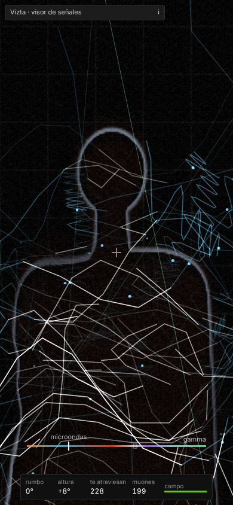
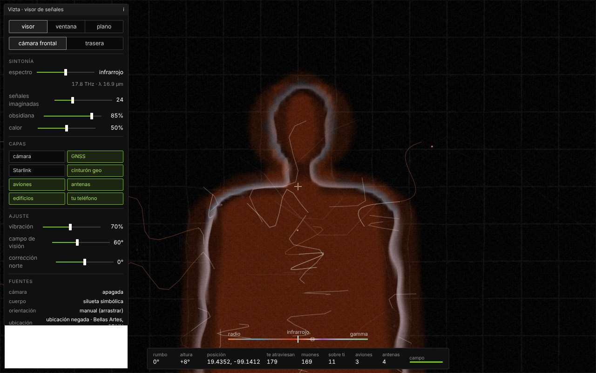
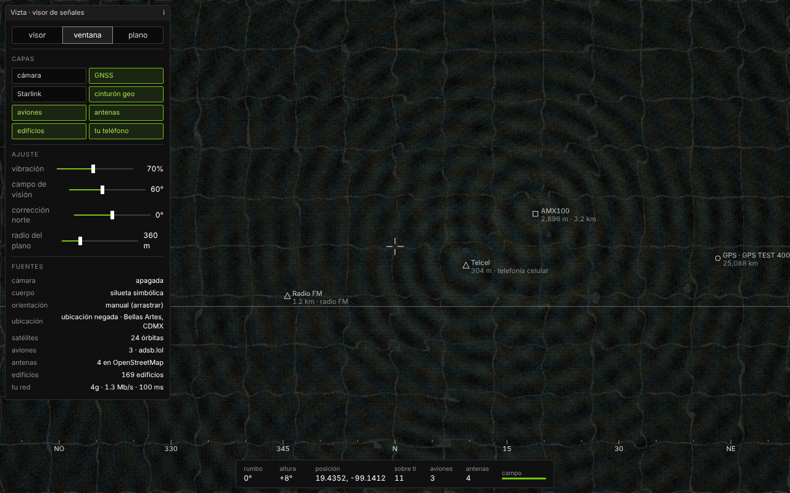
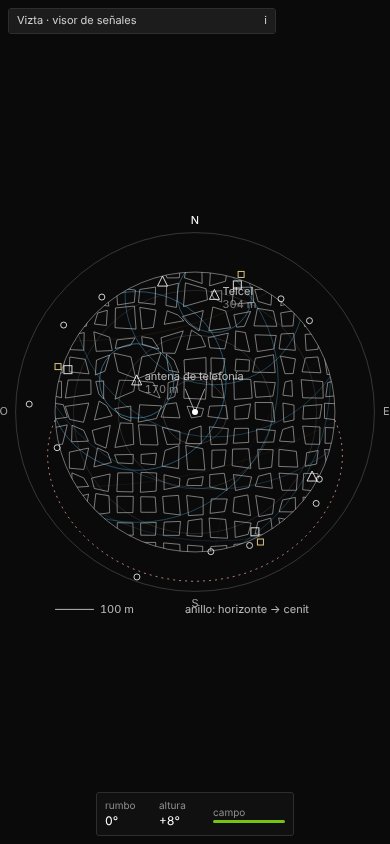

# Vizta

**Español** · [English](#english)

Visor de señales de la colección **Alchemy of Meaning (Alquimia del Significado)**. Una óptica para ver lo que nos atraviesa: en el teléfono, cada línea es una señal que cruza el cuerpo frente a la lente. También tiene una ventana que muestra, sobre la cámara y en su posición real, las señales que nos rodean: los satélites de navegación, Starlink, el cinturón geoestacionario de la TV satelital, los aviones con su transpondedor ADS-B, las antenas de tu entorno y tu propio teléfono.

Las posiciones son reales; las ondas son una interpretación. La separación de cada frente de onda sigue la longitud de onda de su banda y su fuerza baja con la distancia.

## Visor (v0.2)

Una óptica, no un espejo: la cámara frontal (o la trasera) mira al cuerpo que está frente a la lente sin voltear la imagen. Cada línea es una señal que llega desde la dirección real de su fuente y atraviesa el cuerpo:

- **conocidas**: satélites GNSS, Starlink, cinturón geoestacionario, aviones (ADS-B) y antenas (OpenStreetMap);
- **medida**: tu teléfono y su conexión;
- **imaginadas**: redes WiFi y Bluetooth que el navegador no puede escanear (deslizador «señales imaginadas»), y el calor que irradia tu cuerpo;
- **muones**: la lluvia de rayos cósmicos a su tasa real (≈ 1 por cm² por minuto, unos 1 000 por minuto a través de un cuerpo).

El cuerpo se recorta en el teléfono (MediaPipe, sin enviar la imagen) y se vuelve obsidiana. Las líneas que pasan detrás se ocultan, las que lo cruzan brillan, y cada cruce deja una onda. El deslizador **espectro** sintoniza la óptica en escala logarítmica real, de la radio a los rayos gamma: en microondas dominan las señales; en infrarrojo, el calor del cuerpo; en luz visible, la imagen; en rayos X, el cuerpo se vuelve translúcido y quedan los muones. Sin cámara aparece una silueta simbólica.

## Capturas (con datos de prueba)






## Uso

1. Abre la página por **HTTPS** en el teléfono y toca **abrir el visor**. El teléfono pedirá cámara, ubicación y, en iPhone, orientación.
2. **Visor** (teclas `1`, `2`, `3` para visor, ventana y plano): ponte frente a la cámara. Toca un punto de luz para saber qué señal es y si es medida, conocida o imaginada.
3. **Ventana**: apunta el teléfono al cielo o al horizonte. Toca una señal para ver su banda, frecuencia, longitud de onda, distancia y fuente.
4. **Plano**: los edificios de tu entorno (OpenStreetMap) se deforman con el campo. El anillo exterior es el cielo: el borde interior es el horizonte y el exterior, el cenit.
5. Ajustes: espectro, señales imaginadas, obsidiana, calor, vibración, campo de visión, corrección norte (si la brújula se desfasa) y radio del plano.
6. Sin sensores (computadora): **ver sin sensores** y arrastrar para mirar. Teclas: `1` ventana, `2` plano, `h` ocultar la interfaz, flechas para mirar.

## Fuentes de datos

- [CelesTrak](https://celestrak.org) (TLE) con [satellite.js](https://github.com/shashwatak/satellite-js) (SGP4, MIT, incluido en el archivo): GPS, Galileo, GLONASS, BeiDou, ISS y Tiangong, y Starlink si se activa.
- Cinturón de Clarke calculado a 35 786 km.
- ADS-B: [adsb.lol](https://adsb.lol), [airplanes.live](https://airplanes.live) u [OpenSky](https://opensky-network.org).
- [OpenStreetMap](https://www.openstreetmap.org) vía Overpass: antenas y edificios (© colaboradores de OpenStreetMap, ODbL).
- [MediaPipe Tasks Vision](https://ai.google.dev/edge/mediapipe) (Apache-2.0), cargado en tiempo de ejecución desde jsDelivr, para recortar el cuerpo dentro del teléfono.

## Correrlo

Es un solo archivo, sin compilación. La cámara y los sensores solo funcionan con HTTPS (o `localhost`):

```
python3 -m http.server 8000
```

El navegador no puede escanear WiFi ni Bluetooth, así que esas bandas no aparecen como emisores medidos.

## Versión

v0.2 — modo visor: líneas de señal que atraviesan el cuerpo, sintonía del espectro, obsidiana, calor y muones.

## Créditos

Diseño, investigación y desarrollo: Héctor Cruz Juárez — https://hectorcruz.com.mx
Colección Alchemy of Meaning (Alquimia del Significado). Licencia GPL-3.0-or-later.

---

<a id="english"></a>
## English

Signal viewer from the **Alchemy of Meaning (Alquimia del Significado)** collection. An optic for what passes through us: a phone viewer where every line is a signal crossing the body in front of the lens. It also has a window that draws the radio signals around us over the camera, in their real positions. It shows navigation satellites, Starlink, the geostationary TV belt, aircraft broadcasting ADS-B, nearby antennas and your own phone.

Positions are real; the waves are an interpretation. Wavefront spacing follows each band's wavelength, and strength falls with distance.

**Use:** open it over HTTPS on a phone and tap *abrir la ventana*. *Ventana* mode overlays signals on the camera; *plano* mode warps the OpenStreetMap buildings around you, with a sky ring. On a computer, use *ver sin sensores* and drag to look around.

**Data:** CelesTrak + satellite.js (SGP4), computed Clarke belt, ADS-B (adsb.lol / airplanes.live / OpenSky), OpenStreetMap via Overpass (ODbL). Browsers cannot scan WiFi or Bluetooth.

**Version:** v0.2 — viewer mode: signal lines crossing the body (segmented on-device as obsidian), spectrum tuning from radio to gamma on a real log scale, body heat and cosmic-ray muons at their real rate. Lines are tagged as measured, known or imagined.

Design, research and development: Héctor Cruz Juárez — https://hectorcruz.com.mx · GPL-3.0-or-later.
